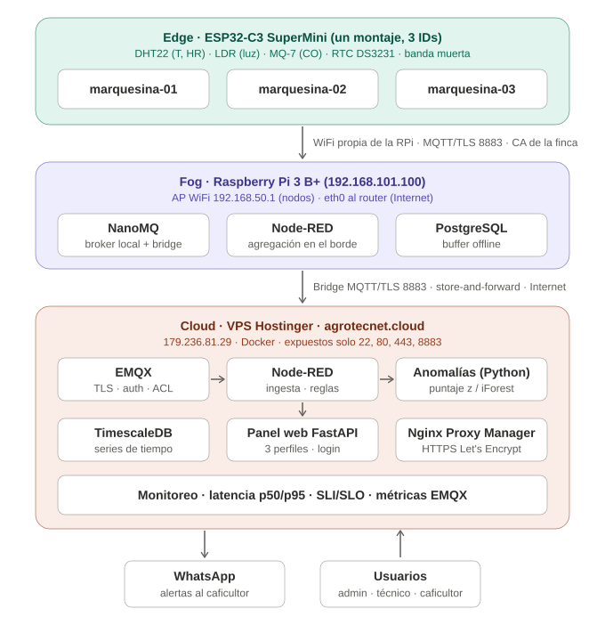

# Monitoreo inteligente del secado de café — solución Cloud-IoT de extremo a extremo

Actividad de aprendizaje 3 · Integración Cloud en IoT [G1-2026B] · CORHUILA
Autor: Ing. Robin Mauricio Dussán Medina

Monitoreo en tiempo real de marquesinas de secado de café pergamino (temperatura, humedad relativa,
radiación solar y CO), con alertas, detección de anomalías, histórico para machine learning y un
**gemelo digital en WebGL**. Construido sobre infraestructura propia: ESP32-C3 (edge) → Raspberry Pi 3 B+
con NanoMQ (fog) → VPS con EMQX, Node-RED, TimescaleDB y un panel web (cloud).



## Arquitectura

| Capa | Componente | Función |
|---|---|---|
| Edge | ESP32-C3 + DHT22, LDR, MQ-7, DS3231 | Un montaje publica como 3 marquesinas (3 clientes MQTT/TLS), banda muerta, hora NTP/RTC |
| Fog | Raspberry Pi 3 B+ | Punto de acceso WiFi propio (nodos sin Internet), NanoMQ con TLS (CA de la finca), bridge TLS con caché offline |
| Cloud | EMQX 6.3.1 | Broker MQTT/TLS 8883 (Let's Encrypt), autenticación y ACL de mínimo privilegio |
| Cloud | Node-RED 5.0.8 | Ingesta, estado online/offline, reglas de alerta con antirebote, Telegram/WhatsApp |
| Cloud | TimescaleDB 2.30 | Series de tiempo con compresión y retención; roles de mínimo privilegio |
| Cloud | Servicio de anomalías | Puntaje z en ventana móvil → `cafe/<id>/anomalia` |
| Cloud | Panel FastAPI | https://panel.agrotecnet.cloud — 3 perfiles, gemelo digital, histórico, SLI/SLO, dataset CSV |
| Cloud | Nginx Proxy Manager | HTTPS de los paneles; únicos puertos expuestos: 22, 80, 443, 8883 |

## Estructura

```
firmware/esp32_marquesina/  Firmware Arduino (secrets.h y ca_fog.h fuera del repositorio)
fog/                        Raspberry: NanoMQ (conf, ACL), red AP, PKI de la finca, stacks
cloud/                      VPS: stacks Docker, ACL de EMQX, esquema SQL, flujos Node-RED, scripts
services/panel/             Panel web (FastAPI + ECharts + Three.js)
services/anomalias/         Detección de anomalías y medición de la optimización
monitoreo/                  Consultas de latencia p50/p95 y SLI/SLO
docs/                       Diagrama, plan de despliegue, evidencias
.github/workflows/          CI/CD (secretos, sintaxis, firmware, imágenes, despliegue)
```

## Cómo ejecutarlo

1. **Nube (VPS con Docker)**: crear la red `docker network create iot_network`; copiar cada `*.example`
   a su archivo real en `/root/a3_secretos/`; levantar `cloud/stacks/*.yml`; aplicar
   `cloud/timescale/01_esquema.sql` y `02_roles.sql`; instalar los flujos (`cloud/nodered/README.md`);
   `docker compose up -d --build` en `services/panel` y `services/anomalias`.
2. **Fog (Raspberry Pi OS + Docker)**: `fog/pki/crear_pki.sh`, `sudo systemd-run fog/red/configurar_red.sh`,
   completar `fog/nanomq/nanomq_pwd.conf` y la clave del bridge, levantar `fog/stacks/*.yml`.
3. **Edge**: copiar `secrets.h.example` → `secrets.h` y `ca_fog.h.example` → `ca_fog.h` (con `ca_finca.crt`),
   compilar en Arduino IDE para *ESP32C3 Dev Module*. Detalle en `firmware/esp32_marquesina/README.md`.

## Seguridad
Ninguna credencial está en el repositorio: claves, tokens y llaves viven solo en los equipos
(`/root/a3_secretos` en el VPS, `~/a3/secretos` en la Raspberry) y aquí solo hay archivos `*.example`.
El CI ejecuta gitleaks en cada push.
